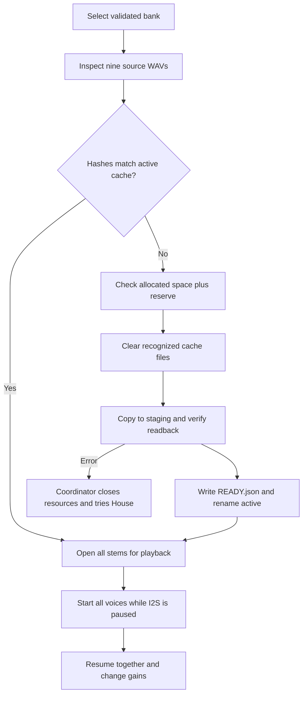

# Keeping nine audio stems synchronized on a Pico

Shaggy's central problem is maintaining a musical timeline while physical controls, file access and display updates compete for a small microcontroller. A tile should change a stem's gain without restarting its loop. A bank change should activate nine compatible files, and an interrupted copy should never become playable audio.

The mechanisms below come from the public firmware and host tests. The tradeoff explanations are interpretations of that code, not a claim about the author's original reasoning or measured hardware performance.

## Follow a bank from SD card to speaker

[`shaggy_os.run()`](firmware/shaggy_os.py) creates `SDStorage`, attempts a mount and calls [`load_library()`](firmware/music_library.py). A missing card or invalid manifest leaves the internal House bank selected. Manifest validation bounds the input and constructs the available bank list before the library picker operates on it.

For an SD-selected bank, the coordinator calls [`prepare_bank()`](firmware/bank_cache.py). That function checks every expected WAV against the bank's sample rate and frame count. For a cache hit, it compares SHA-256 hashes of both the source and cached files with `READY.json`. Matching titles or file lengths alone cannot admit stale audio.

On a miss, `_preflight_space()` rounds file sizes to filesystem allocation blocks and reserves another 65,536 bytes. It counts space reclaimable from recognized cache files. Only after that check does the code clear the old staging and active directories. It copies each file in 4,096-byte chunks, checks for short writes, inspects the copied WAVs and hashes their readback. It writes the readiness marker last, then renames staging to active.

This is a publication boundary, not a two-bank rollback scheme. The previous active cache is removed before copying its replacement. A failed copy therefore can leave neither requested nor previous cached bank available. The independent `/beats/house` bank provides recovery, and `prepare_bank()` rejects cache paths that overlap it. Even House must contain valid audio; the fallback is not a guarantee when internal storage itself is damaged.

## The control loop changes gain, not phase

[`shaggy.run()`](firmware/shaggy.py) opens all nine files and rejects differing sample rates or frame counts before enabling the DAC. It configures nine mixer voices, starts I2S, pauses it, starts each looping voice, then resumes. The host test `test_starts_all_voices_while_paused_before_resuming` checks this call order. It does not measure physical phase alignment at the analog output.

The main loop samples the active-low Hall inputs and passes their state plus elapsed monotonic time to [`StemControl.update()`](firmware/stem_control.py). Each sensor has a candidate state and held duration. The active bit changes after the candidate remains stable for the debounce interval. The gain moves toward zero or the configured stem level independently of loop restart. `changed_mask` identifies the voices whose gain or active state changed, so the player does not rewrite all nine voice levels on every iteration.

The display receives a separate time budget. The loop redraws only when its frame deadline arrives and no stem changes occurred in that iteration. It schedules the next frame after both the display interval and a minimum control window. This reduces immediate contention; it does not make CircuitPython a hard real-time scheduler. Persistent sensor activity can defer display work, and a slow operation can still lengthen a control iteration.

## A worked sensor transition

The defaults are a 20 ms debounce, a 20 ms fade and a target gain of 0.35. The fade rate is therefore `0.35 / 0.020 = 17.5` gain units per second.

For an initially absent tile, suppose the first present sample arrives at time zero and later samples arrive every 10 ms:

| Time after first observation | State after `update()` | Stem gain |
| --- | --- | ---: |
| 0 ms | New candidate, debounce begins | 0.000 |
| 10 ms | Candidate held for 10 ms | 0.000 |
| 20 ms | Active bit changes; the interval finished the debounce | 0.000 |
| 30 ms | First 10 ms of fade | 0.175 |
| 40 ms | Fade reaches its target | 0.350 |

The first observation deliberately does not claim the signal was stable during the preceding unsampled interval. When a later iteration crosses the debounce boundary, `update()` splits that interval between the old and new target. A long iteration therefore cannot apply a full fade interval before the state actually became active. This is elapsed-time arithmetic, not a guarantee that physical response is always 40 ms.

The storage budget explains the flash cache. Nine 22,050 Hz, mono, 16-bit streams contain `9 × 22,050 × 2 = 396,900 bytes/s` of PCM. At 44,100 Hz the payload is 793,800 bytes/s, before filesystem access or display transfers. These are required payload rates, not measured SD throughput.

## Tradeoffs visible in the implementation

**Flash playback trades startup work for fewer SD reads during playback.** Copying and hashing a bank adds selection latency and flash writes. A cache hit avoids rewriting but still reads source and cached data to verify hashes. Direct SD streaming would avoid copying and accommodate larger banks, but shares bus time and card-latency variation with the display. The player retains an SD path, while the library coordinator normally hands it a flash path.

**One active cache trades rollback depth for available capacity.** Retaining the old bank until the new one is complete would require space for both. The current preflight allows reclaiming the active bank, then relies on House if replacement fails. Tests distinguish preflight failures, which preserve the old cache, from interrupted copies, which must not publish staging.

**Continuous loops trade computation for phase continuity.** Muted stems continue to play while their gains are zero. Starting a voice only when a tile appears could reduce active processing, but would require a common playback position to avoid restarting each stem on a different beat.

**Zero takeover trades convenience for predictable bank changes.** After selection, the coordinator sets `wait_for_zero`. Playback stays muted until the physical knob reaches at most 1%. This prevents the old knob position from immediately setting a new bank's volume. The cost is an extra user action; relative controls or a dedicated selection encoder would need different hardware or interaction rules.

## What the tests establish, and the next experiment

[`test_bank_cache.py`](tests/test_bank_cache.py) injects corruption, source changes, short copies, readback failures and failed activation. It also checks that cleanup refuses unknown files. [`test_player.py`](tests/test_player.py) checks mute behavior, resource cleanup, zero takeover and DAC-fault handling with fake interfaces. [`test_stem_control.py`](tests/test_stem_control.py) checks the timing logic. None measures DAC underruns, acoustic clicks, filesystem durability after power loss or flash lifetime.

A proposed next bench experiment is a 30-minute run with all nine stems, normal display updates and 100 scripted tile transitions. Capture the analog output and timestamp control-loop iterations. Use generated audio with known loop markers. After accounting for capture-clock drift, require zero unexpected voice stops and zero new gaps of 5 ms or longer relative to the reference. Report maximum control-loop duration rather than only its average. Separately interrupt bank copying at each file boundary across 20 trials; each reboot must produce either a fully verified selected bank or valid House playback, never partially copied audio. Those are proposed acceptance criteria, not completed results.
