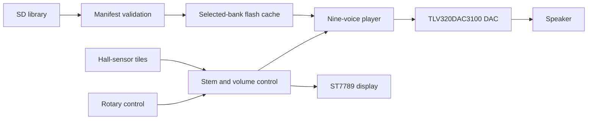

# Shaggy

A physical music controller built around Raspberry Pi Pico 2. Nine Hall-sensor tiles bring individual audio stems in and out of a mix. A rotary control handles volume and library selection, and a small LCD shows the current bank and active stems.

This repository contains CircuitPython firmware, host-side preparation and installation tools, tests, and a KiCad carrier-board design. Audio recordings and device-specific backups are excluded.

## What works in the code

- Nine stem controls with time-based fades and debounced sensor state.
- SD-card libraries with validated manifests and up to 64 banks.
- Flash caching before playback, so active voices do not compete with the display for SD bandwidth.
- An internal House-bank recovery path when the SD card or library fails.
- Volume takeover, hold gestures and a library picker on a 240 x 280 display.
- Staged installation with file hashes, readback checks, backups and rollback paths.



## Engineering decisions

The SD card and display share SPI. Loading a bank into flash before playback avoids asking that bus to sustain every audio stream while redrawing the UI. `bank_cache.py` verifies WAV structure and available space before activating a cached bank.

The installer treats partial writes as a failure. It stages replacements, verifies content, and retains the prior files until activation succeeds. The tests inject write and reconnect failures to check the rollback path.

## Source map

| Path | Responsibility |
| --- | --- |
| [`firmware/shaggy_os.py`](firmware/shaggy_os.py) | Library startup, selected bank, recovery and playback sessions |
| [`firmware/shaggy.py`](firmware/shaggy.py) | Pico GPIO, audio mixer and playback loop |
| [`firmware/bank_cache.py`](firmware/bank_cache.py) | Validated SD-to-flash bank caching |
| [`firmware/player_display.py`](firmware/player_display.py) | Bank, stem, volume and error display |
| [`tools/prepare_sd_library.py`](tools/prepare_sd_library.py) | WAV validation, resampling and aligned SD library output |
| [`tools/install_sd.py`](tools/install_sd.py) | Staged firmware/library deployment and recovery |
| [`hardware/pcb/`](hardware/pcb/) | Carrier-board sources, footprint definitions and design scripts |
| [`tests/`](tests/) | Host-side logic and failure-injection tests |

## Run the host tests

Use Python 3.13 or 3.14 and [uv](https://docs.astral.sh/uv/).

```sh
uv sync --group dev
uv run pytest -q
uv run ruff check firmware tools tests
```

The public source snapshot passed **568 tests on November 9, 2026**. Two optional resampling tests skipped because NumPy was absent from that environment. A separate carrier-board netlist suite passed 11 tests. Ruff passed for firmware, tools and tests. These tests use fake hardware interfaces; they do not establish timing or audio quality on a physical Pico.

## Hardware and audio setup

The implementation targets a Pico 2 running CircuitPython, a TLV320DAC3100 audio board, an ST7789 display, nine Hall sensors, a volume potentiometer and an SPI microSD reader. Pin assignments live in `firmware/shaggy.py`, `firmware/sd_storage.py` and `firmware/volume_test.py`. Confirm power rails and actual module pinouts before wiring.

Supply your own licensed audio. Each bank uses nine mono, 16-bit PCM WAV files with matching frame counts. The SD preparation path produces 22,050 Hz files and validates the bank before deployment. The runtime and tests do not require redistributing the original recordings.

Run `python tools/install_sd.py --help` before connecting a board. Device installation writes firmware and storage; the desktop test command above does not open a physical device.

## Current limits and next work

The carrier PCB is a prototype design. A passing software suite or KiCad check does not prove a fabricated board works. The next hardware checks are long-duration playback with all nine stems, bank changes under realistic card latency, power-cycle recovery and end-to-end wiring review.

The public suite excludes acceptance tests that depended on private audio recordings. General WAV, manifest, caching and installation tests generate their own fixtures.
